# Skin Lesion Recognition

皮膚病變影像辨識系統。  
使用者透過**網站**上傳或拍攝皮膚影像，系統會同時完成兩件事：

1. **疾病分類**：判斷影像屬於7種常見皮膚病變中的哪一種，並附上疾病說明
2. **病灶分割**：產生病灶區域的像素級遮罩，標示出病灶的位置與範圍

系統另外提供**Android App**，可以用手機鏡頭即時辨識。

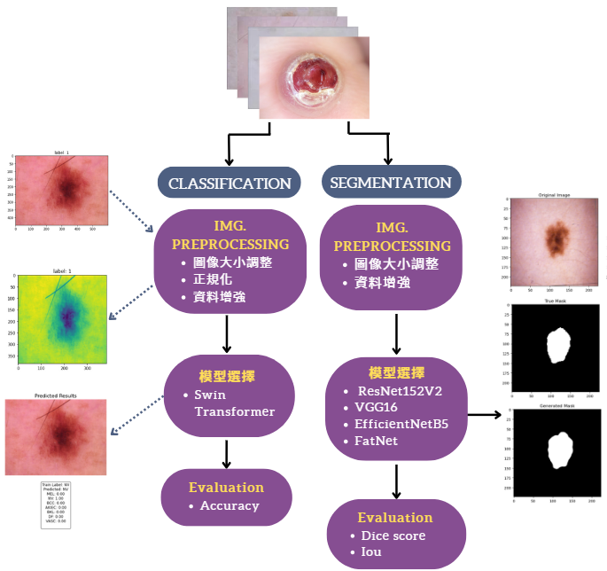

- **深度學習**：PyTorch、timm(Swin Transformer)、FAT-Net
- **網站**：Python、Flask、HTML/CSS/JavaScript
- **部署**：IIS反向代理、HTTPS、自有網域
- **App**：Android Studio、Java、CameraX、PyTorch Mobile
- **資料集**：ISIC 2018、ISIC 2016、PH2

> 本系統定位為輔助工具，辨識結果僅供參考，無法取代專業醫師的診斷。

## 成果

| 任務 | 模型 | 結果 |
|---|---|---|
| 病灶分割 | FAT-Net | Dice 0.9033、IoU 0.880 |
| 疾病分類(7類) | Swin Transformer | Accuracy 0.90 |

可辨識的7種皮膚病變：

| 代碼 | 疾病 | 代碼 | 疾病 |
|---|---|---|---|
| MEL | 惡性黑色素瘤(Melanoma) | BKL | 良性角化病變(Benign Keratosis) |
| NV | 黑色素細胞痣(Melanocytic Nevus) | DF | 皮膚纖維瘤(Dermatofibroma) |
| BCC | 基底細胞癌(Basal Cell Carcinoma) | VASC | 血管病變(Vascular Lesion) |
| AKIEC | 光化性角化病與上皮內癌(Actinic Keratosis and Intraepithelial Carcinoma) | | |

## 網站

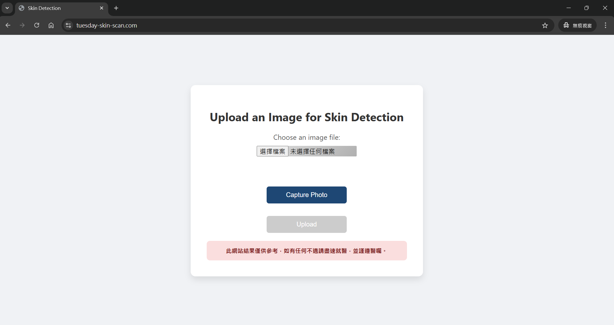

- **上傳照片**：選擇電腦或手機中的皮膚影像，按下`Upload`後約1至2秒即可看到結果。
- **相機拍攝**：按下`Capture Photo`開啟裝置相機，可切換前後鏡頭，拍照後直接上傳辨識。
- **結果呈現**：回傳一張結果圖，包含原始影像、病灶遮罩，以及預測的疾病名稱與說明。
- **提醒**：頁面下方提醒使用者結果僅供參考，如有不適應盡速就醫。

### 網站辨識結果

| MEL | NV |
|---|---|
| 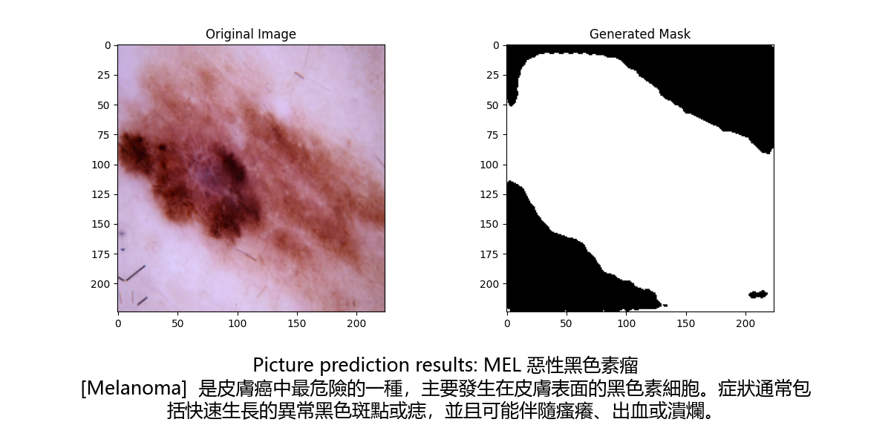 | 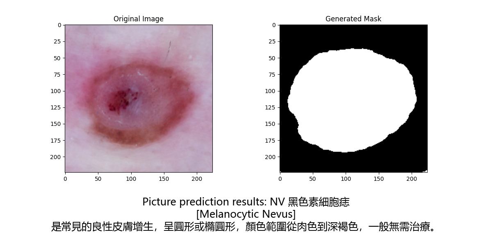 |

| BCC | AKIEC |
|---|---|
| 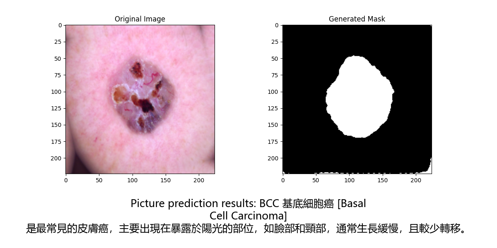 | 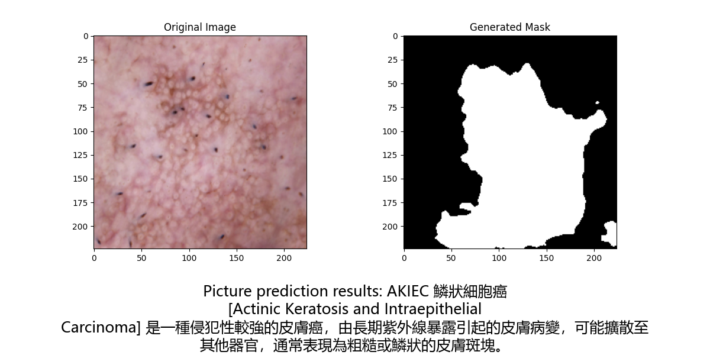 |

| BKL | DF |
|---|---|
| 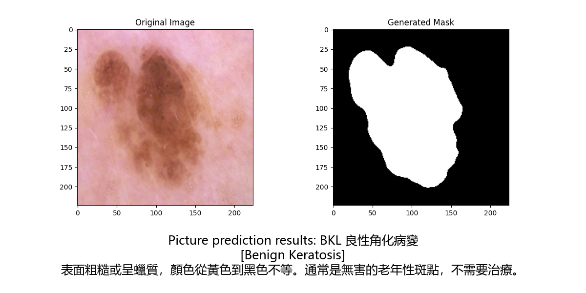 | 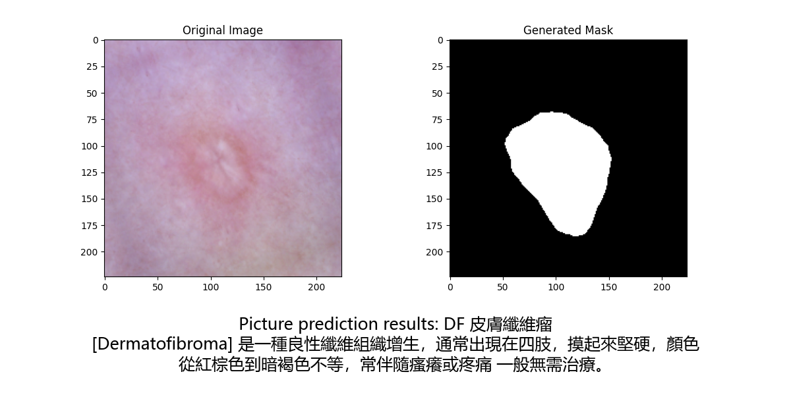 |

| VASC |
|---|
| 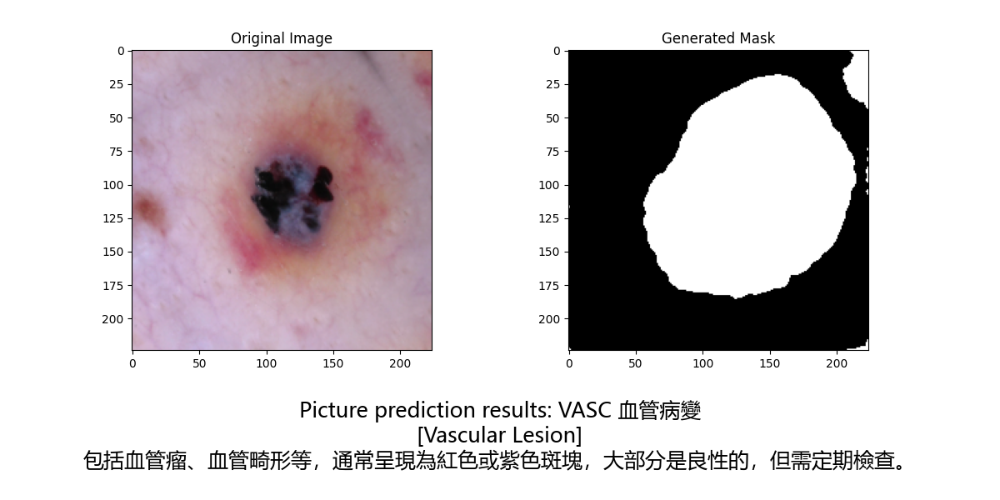 |

### 後端流程

1. 接收上傳的影像，調整為384×384並正規化，交給Swin Transformer預測疾病類別。
2. 再將影像調整為224×224，交給FAT-Net產生病灶遮罩。
3. 將遮罩**歸一化**後，以高斯模糊平滑邊緣並**二值化**(門檻0.6)，讓遮罩邊界清楚。
4. 用matplotlib把原圖、遮罩與疾病說明畫成一張PNG回傳給前端。

### 部署

- 網站以**IIS**作為對外的網站伺服器，透過URL Rewrite反向代理到Flask服務([`web/web.config`](web/web.config))。
- 前端的相機功能必須在**安全連線**下才能使用，因此網站一開始用自簽憑證測試，正式上線時改用正式憑證啟用**HTTPS**。
- 購買自有網域`tuesday-skin-scan.com`並將原本的網址轉到該網域；之後修改程式時只要更新主機上的服務，不需要重新部署到其他雲端平台。

## Android App

App使用CameraX取得鏡頭畫面，將皮膚部位對準鏡頭3至5秒，即可在畫面上看到辨識出的疾病類別與分割遮罩。

| BCC | NV | VASC | MEL |
|---|---|---|---|
| 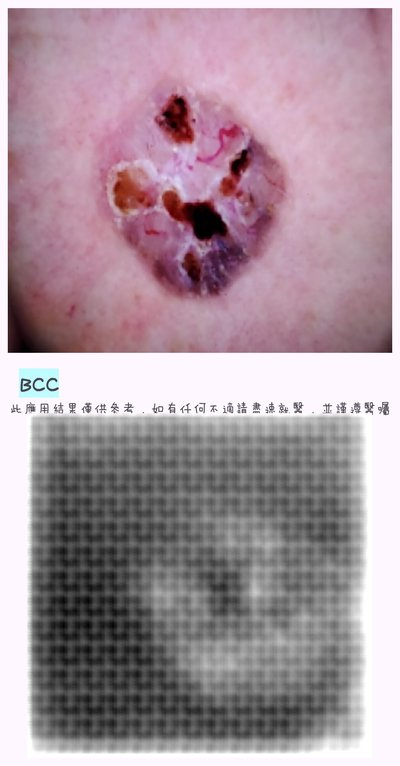 | 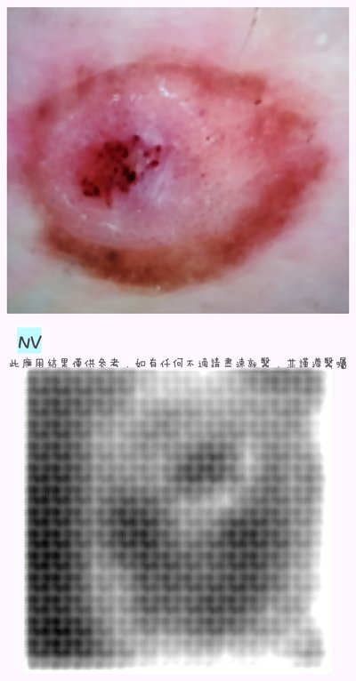 | 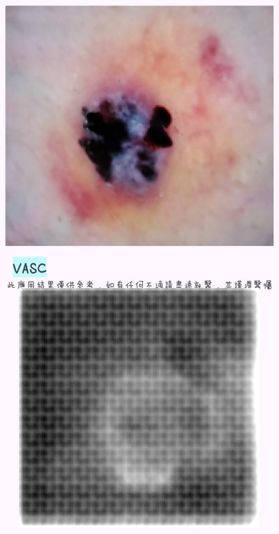 | 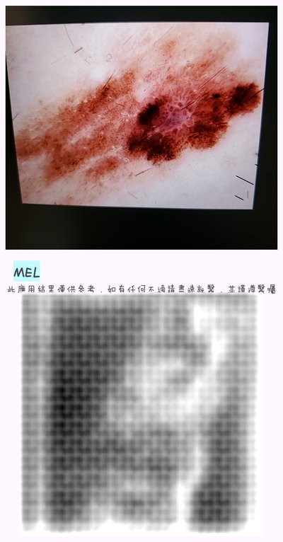 |

| AKIEC | BKL | DF |
|---|---|---|
| 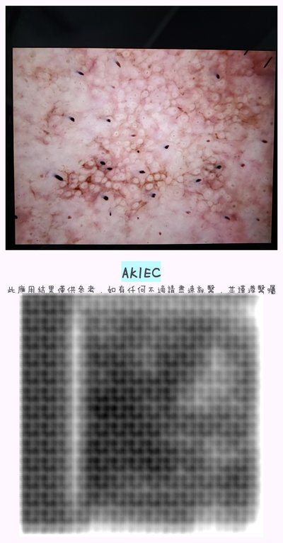 | 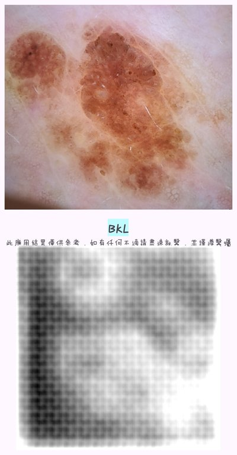 | 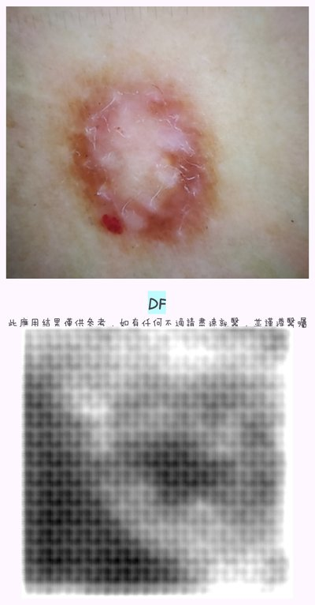 |

- 原本規劃把模型轉成TensorFlow Lite(`.tflite`)，但Swin Transformer無法順利轉換，因此改用**PyTorch Mobile**：把模型匯出成`.ptl`，和類別名稱的`.txt`一起放進App的`assets`資料夾。
- 鏡頭畫面透過`ImageAnalysis`轉成張量後送進模型推論，遮罩再經過歸一化與對比度增強後顯示。
- 目前App產生的遮罩不如網站清楚，辨識速度也比網站慢幾秒，是之後可以改進的地方。

## 模型

### 病灶分割：比較4種模型

以ISIC 2018、ISIC 2016與PH2資料集訓練，訓練資料4,028張、測試資料202張。影像統一調整為224×224，並使用隨機旋轉(35度內)、水平翻轉(50%)、垂直翻轉(10%)做資料增強。損失函數為`BCEWithLogitsLoss`，優化器Adam，訓練100 epochs。

| 模型 | Dice Score | IoU | 參數量 |
|---|---|---|---|
| **FAT-Net** | **0.9033** | 0.880 | **30.0M** |
| EfficientNetB5 | 0.8979 | 0.908 | 30.6M |
| ResNet152V2 | 0.8839 | 0.822 | 60.4M |
| VGG16 | 0.8827 | 0.849 | 138.4M |

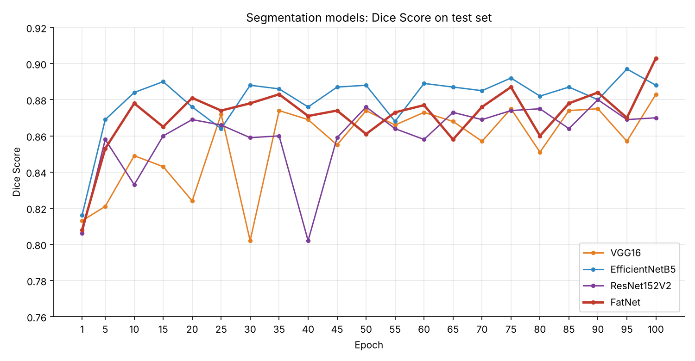

最後選用**FAT-Net**：Dice Score最高，參數量也最小，方便轉成手機模型放進App。FAT-Net在CNN編碼器旁加入Transformer分支，可以同時掌握影像的局部細節與全局資訊，並以特徵自適應模組(FAM)融合多層特徵，適合處理形狀不規則、邊界模糊的病灶。

### 疾病分類：Swin Transformer

以ISIC 2018 Task 3資料集訓練，訓練影像10,015張、測試影像1,512張。使用`swin_base_patch4_window12_384`，影像調整為384×384並正規化，以3-fold Stratified K-Fold交叉驗證訓練，優化器Adam搭配CosineAnnealingWarmRestarts學習率排程。在測試資料上的準確率為**0.90**。

## 開發過程中的問題與解決

- **遮罩邊界模糊、顏色過淡**：網站產生的遮罩和訓練測試時不同，透過歸一化、平滑與二值化處理解決。
- **相機功能無法使用**：瀏覽器只在安全連線下開放相機，先以自簽憑證測試，之後改用正式憑證與自有網域。
- **模型無法轉成TensorFlow Lite**：改用PyTorch Mobile匯出`.ptl`模型。
- **環境問題**：中途加裝GPU後原本的Python環境無法使用，重新建立環境；網站主機環境不同導致模型無法載入，補裝對應的函式庫後解決。
- **準確率不足**：增加模型的訓練量來提升準確率。

## 專案結構

```
Skin-Lesion-Recognition/
├── web/                        網站
│   ├── app.py                  Flask後端：疾病分類、病灶分割與結果圖產生
│   ├── templates/index.html    上傳與相機拍攝介面
│   └── web.config              IIS反向代理設定
├── training/                   模型訓練
│   ├── segmentation.ipynb      分割模型訓練與比較(FAT-Net、ResNet152V2、VGG16、EfficientNetB5)
│   └── classification.ipynb    Swin Transformer疾病分類訓練
├── requirements.txt
└── docs/images/                系統流程圖與辨識結果
```

## 安裝與執行

1. 安裝套件：

   ```bash
   pip install -r requirements.txt
   ```

2. 準備資料集並訓練模型(資料夾結構寫在各notebook開頭)：
   - [ISIC 2018 Task 1-3](https://challenge.isic-archive.com/data/#2018)、[ISIC 2016](https://challenge.isic-archive.com/data/#2016)
   - [PH2](https://www.fc.up.pt/addi/ph2%20database.html)

3. 把訓練好的模型放在`web/model_files/`：
   - `swin_classifier.pth`：Swin Transformer分類模型
   - `fatnet_segmentation.pth.tar`：FAT-Net分割模型

4. 啟動網站：

   ```bash
   cd web
   python app.py      # http://127.0.0.1:5000
   ```

   結果圖中的中文說明需要中文字型，Windows預設使用微軟雅黑，其他系統可用環境變數`CJK_FONT`指定字型檔路徑。

## 說明

- 模型權重每個約350MB，超過GitHub的檔案大小限制，因此沒有收錄。
- 分割模型的訓練流程參考Kaggle筆記本[Skin Lesion Segmentation Using UNET](https://www.kaggle.com/code/dota2player/skin-lesion-segmentation-using-unet)，FAT-Net架構來自論文[FAT-Net: Feature adaptive transformers for automated skin lesion segmentation](https://doi.org/10.1016/j.media.2021.102327)；分類模型改寫自公開的Swin Transformer影像分類範例，並參考論文[Swin Transformer](https://arxiv.org/abs/2103.14030)。
- 資料來源：Codella et al., "Skin Lesion Analysis Toward Melanoma Detection 2018: A Challenge Hosted by the International Skin Imaging Collaboration (ISIC)", [arXiv:1902.03368](https://arxiv.org/abs/1902.03368)。

## 開發分工

本專題為4人團隊開發，技術開發與實作主要由我與另一位組員負責。  
我負責的部分：
- **網站前後端開發**：上傳與相機拍攝介面、Flask後端與結果圖呈現
- **模型整合**：把分類與分割模型串接進網站，並處理遮罩不清楚等問題
- **系統部署**：IIS部署、HTTPS與網域設定，完成網站上線
- 與團隊共同研究深度學習模型與訓練方法
- 與另一位技術組員合作進行程式除錯、病灶分割結果優化與App功能調整
- 與另一位技術組員共同負責系統測試與最終成果展示
