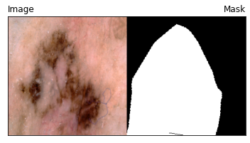
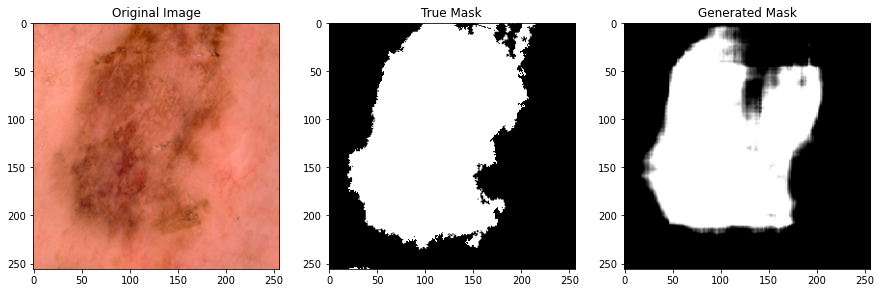

# U-Net病灶分割

以經典的**U-Net**作為病灶分割的第一個基準模型，建立從資料讀取到評估的完整流程。

- **資料集**：ISIC 2018 Task 1(皮膚影像與病灶標註遮罩)，80%訓練、20%測試
- **前處理**：影像調整為256×256；隨機旋轉(35度內)、水平翻轉(50%)、垂直翻轉(10%)
- **訓練**：`BCEWithLogitsLoss`、Adam(lr 3e-4)、batch size 32、混合精度訓練，共訓練25 epochs
- **評估**：Dice Score

## 結果

測試資料的**Dice Score為0.808**。

| 資料與標註遮罩 | 原圖、標註遮罩與U-Net預測遮罩 |
|---|---|
|  |  |

U-Net能抓出病灶的大致範圍，但邊界較粗糙，病灶與周圍皮膚對比低時容易漏判。之後改用FAT-Net等加入Transformer或更強編碼器的模型，並增加ISIC 2016與PH2的訓練資料，Dice Score提升到0.90([`training/segmentation.ipynb`](../../training/segmentation.ipynb))。

## 檔案

- [`unet_segmentation.ipynb`](unet_segmentation.ipynb)：U-Net架構、資料讀取、訓練與評估

訓練流程參考Kaggle筆記本[Skin Lesion Segmentation Using UNET](https://www.kaggle.com/code/dota2player/skin-lesion-segmentation-using-unet)。
