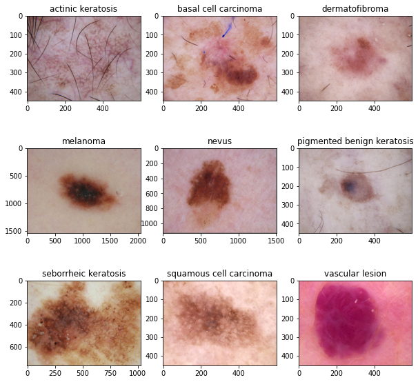
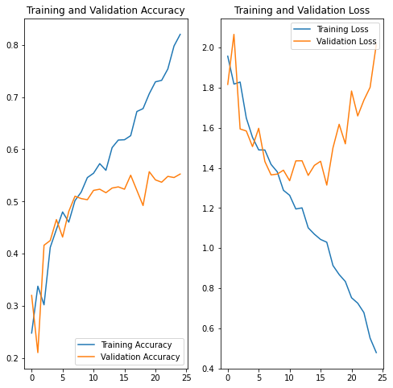
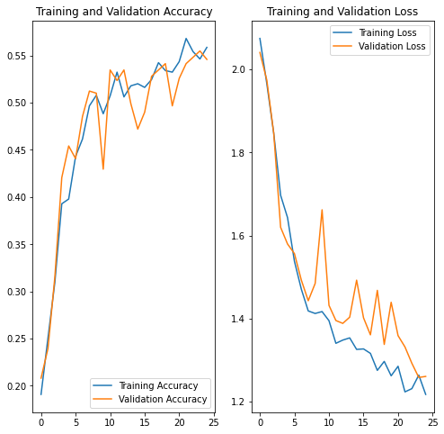
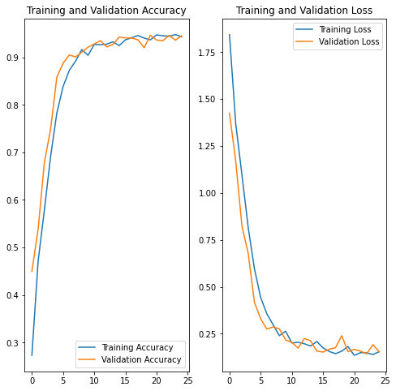
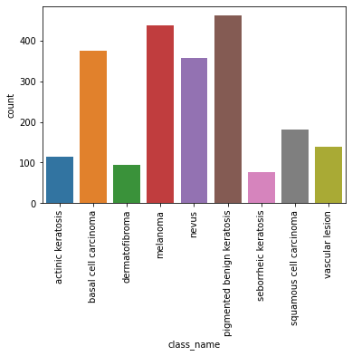
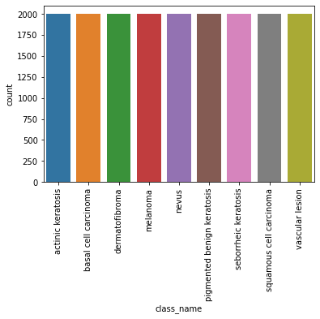

# CNN 9類皮膚病分類

以TensorFlow/Keras自建CNN，對9類皮膚病變進行分類，觀察過擬合與類別不平衡對模型的影響。

- **資料集**：[Skin Cancer ISIC 9 classes](https://www.kaggle.com/datasets/nodoubttome/skin-cancer9-classesisic)，訓練影像2,239張(80%訓練、20%驗證)、測試影像118張
- **類別**：光化性角化病、基底細胞癌、皮膚纖維瘤、黑色素瘤、痣、色素性良性角化病、脂漏性角化病、鱗狀細胞癌、血管病變
- **前處理**：影像調整為180×180

## 三個模型的比較

| 模型 | 做法 | 訓練準確率 | 驗證準確率 |
|---|---|---|---|
| Model 1 | 基本CNN(5層卷積+池化、全連接層) | 0.82 | 0.55 |
| Model 2 | 加入隨機翻轉、旋轉、縮放的資料增強，並在卷積層後加入Dropout | 0.56 | 0.55 |
| Model 3 | 以Augmentor把每個類別擴增到2,000張，平衡類別數量 | 0.94 | 0.95 |

| Model 1：過擬合 | Model 2：資料增強+Dropout | Model 3：類別平衡 |
|---|---|---|
|  |  |  |

- **Model 1**：訓練準確率持續上升，但驗證準確率停在0.55附近、驗證loss反而上升，明顯過擬合。
- **Model 2**：加入資料增強與Dropout後，訓練與驗證的差距縮小，但整體準確率偏低。
- **Model 3**：原始資料各類別數量差距很大(77~462張)，擴增成每類2,000張後，驗證準確率提升到0.95。

| 類別平衡前 | 類別平衡後 |
|---|---|
|  |  |

## 發現的問題

Model 3在獨立測試資料上的準確率只有**0.42**。驗證資料同樣來自擴增後的影像，與訓練資料過於相似，讓驗證準確率高估了模型的真實表現。這個實驗讓我們確認：

- 評估時必須使用沒有經過擴增的獨立測試資料
- 只靠旋轉、翻轉擴增少數類別，無法真正補足資料多樣性

因此之後改用資料量較完整的ISIC 2018 Task 3，並搭配ImageNet預訓練模型進行遷移學習。

## 檔案

- [`cnn_9class_classification.ipynb`](cnn_9class_classification.ipynb)：資料讀取、3個模型的訓練與評估

改寫自Kaggle筆記本[Skin Cancer Detection](https://www.kaggle.com/code/sharanharsoor/skin-cancer-detection)。
