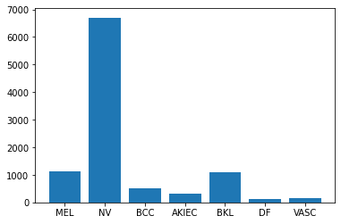

# ResNet152遷移學習分類

改用ISIC 2018 Task 3的7類資料，以ImageNet預訓練的**ResNet152**進行遷移學習。

- **資料集**：ISIC 2018 Task 3，訓練影像10,015張
- **類別不平衡處理**：各類別數量差距很大(NV有6,705張、DF只有115張)，依類別數量的倒數設定抽樣權重，以`WeightedRandomSampler`讓每個batch的類別分布更平均
- **前處理**：縮放到360後中心裁切為224×224，隨機水平/垂直翻轉，ImageNet正規化
- **訓練**：把最後的全連接層換成7類輸出並凍結前段卷積層，以SGD(lr 1e-5、momentum 0.9)微調分類層，batch size 200

## 結果

訓練5 epochs，每個epoch約3分鐘，loss從1.311下降到1.177([`training-log.json`](training-log.json))。

| Epoch | 1 | 2 | 3 | 4 | 5 |
|---|---|---|---|---|---|
| Loss | 1.311 | 1.243 | 1.215 | 1.194 | 1.177 |

loss下降緩慢，若要達到理想的準確率需要大量訓練時間。之後改用能同時掌握局部與全局特徵的Swin Transformer，並以3-fold交叉驗證訓練，準確率達到0.90([`training/classification.ipynb`](../../training/classification.ipynb))。

## 檔案

- [`resnet152_classification.ipynb`](resnet152_classification.ipynb)：資料前處理、加權抽樣、模型訓練與預測輸出
- [`training-log.json`](training-log.json)：每個epoch的loss與訓練時間

改寫自[naneja/isic2018](https://github.com/naneja/isic2018)。
