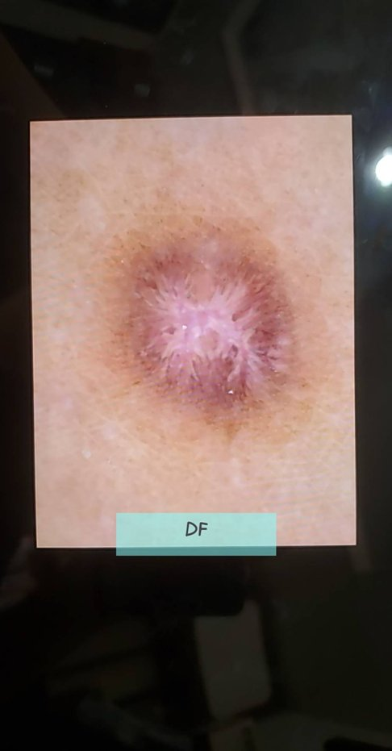
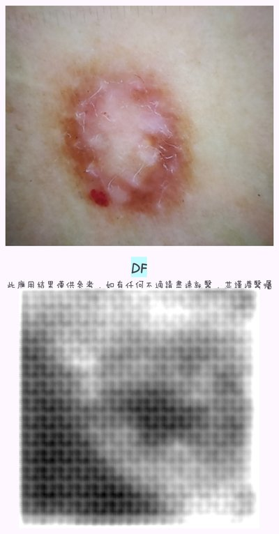

# TensorFlow Lite轉換嘗試

App最初規劃使用TensorFlow Lite：把PyTorch訓練的分類模型轉成`.tflite`，再透過Android Studio的ML Model Binding匯入App。

## 流程

1. 將Swin Transformer的`.pth`模型依序轉成ONNX、TensorFlow，再轉成`.tflite`
2. 以[`labels.txt`](labels.txt)產生模型的metadata(7種疾病類別)
3. 在Android Studio中以`New > Other > TensorFlow Lite Model`匯入模型，自動產生`ModelMeta`類別
4. [`MainActivity.kt`](MainActivity.kt)：以相機或相簿取得影像，縮放為224×224後送進模型，顯示機率最高的類別

## 遇到的問題

Swin Transformer在轉換過程中遇到不支援的運算，轉出的`.tflite`模型無法在App中正常使用，卡關很久。

## 解決方式

改用**PyTorch Mobile**：以`torch.jit.trace`與`optimize_for_mobile`把模型直接匯出成`.ptl`，和類別名稱的`.txt`一起放進App的`assets`資料夾，App端改以Java搭配CameraX即時取得鏡頭畫面進行推論。分割模型的匯出程式在[`training/segmentation.ipynb`](../../training/segmentation.ipynb)最後一段。

| 早期App：只顯示分類結果 | 最終App：分類+分割遮罩 |
|---|---|
|  |  |
