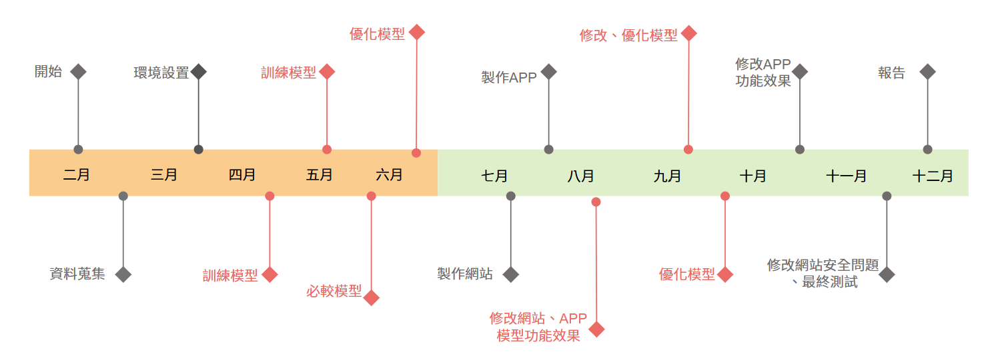

# 模型開發實驗紀錄

在確定最終使用的FAT-Net與Swin Transformer之前，團隊先嘗試了多種模型與做法，以下保留各階段的實驗程式與結果。最終訓練程式在[`training/`](../training/)。

| 順序 | 實驗 | 任務 | 結果與收穫 |
|---|---|---|---|
| 1 | [U-Net病灶分割](01-unet-segmentation/) | 分割 | 第一個分割基準模型，Dice Score 0.808；建立資料讀取、資料增強、訓練與評估的完整流程，之後的分割模型都沿用這套流程 |
| 2 | [CNN 9類皮膚病分類](02-cnn-classification/) | 分類 | 自建CNN從過擬合(訓練0.82、驗證0.55)開始，依序加入資料增強、Dropout與類別平衡，驗證準確率提升到0.95；但測試準確率只有0.42，發現擴增資料與真實資料分布落差的問題 |
| 3 | [ResNet152遷移學習](03-resnet152-classification/) | 分類 | 改用ISIC 2018的7類資料與ImageNet預訓練ResNet152，以加權抽樣處理類別不平衡 |
| 4 | Swin Transformer | 分類 | 改寫公開的Swin Transformer影像分類範例，加入3-fold交叉驗證，準確率達0.90，成為最終的分類模型([`training/classification.ipynb`](../training/classification.ipynb)) |
| 5 | 4種分割模型比較 | 分割 | 以ISIC 2018、ISIC 2016與PH2訓練FAT-Net、ResNet152V2、VGG16、EfficientNetB5並比較，FAT-Net的Dice Score最高(0.9033)，成為最終的分割模型([`training/segmentation.ipynb`](../training/segmentation.ipynb)) |
| 6 | [TensorFlow Lite轉換](04-tflite-conversion/) | App | 嘗試把模型轉成`.tflite`放進Android App，但Swin Transformer無法順利轉換，最後改用PyTorch Mobile(`.ptl`) |

## 資料集

| 資料集 | 用途 |
|---|---|
| [HAM10000](https://doi.org/10.7910/DVN/DBW86T) | 初期資料探索 |
| [ISIC 2018 Task 1](https://challenge.isic-archive.com/data/#2018) | 病灶分割 |
| [ISIC 2018 Task 3](https://challenge.isic-archive.com/data/#2018) | 7類疾病分類 |
| [ISIC 2016](https://challenge.isic-archive.com/data/#2016)、[PH2](https://www.fc.up.pt/addi/ph2%20database.html) | 補充分割訓練資料 |
| [Skin Cancer ISIC 9 classes](https://www.kaggle.com/datasets/nodoubttome/skin-cancer9-classesisic) | CNN分類實驗 |

各實驗的資料集需自行下載，資料夾位置寫在每個notebook的開頭。
